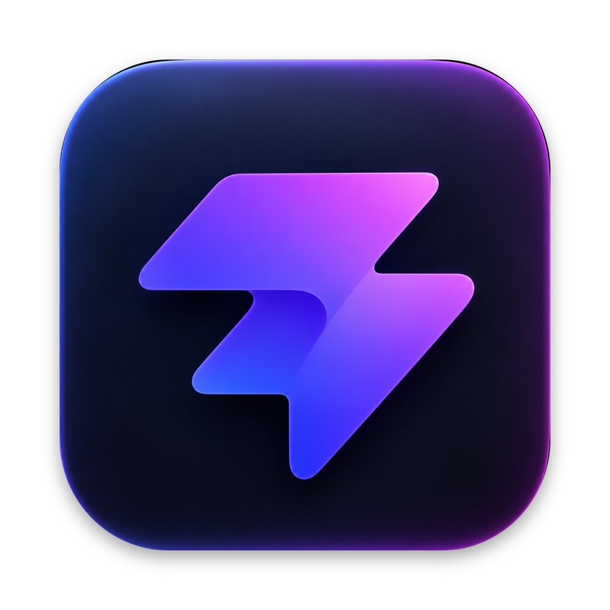

<p align="center">
  
</p>

<h1 align="center">Nook</h1>

<p align="center">
  A self-hosted, Notion-style workspace for notes, pages and databases.<br />
  One Go binary, one SQLite file. Runs comfortably on modest hardware.
</p>

---

## Why

Most self-hosted Notion alternatives need a whole stack to run: Postgres,
Redis, object storage, a separate auth service, several containers. Nook
is the opposite: a single binary with the web app built in, and all data
in one SQLite file next to an uploads folder. Easy to run, easy to back
up, easy to move.

## Features

- **Pages** with a block editor: headings, lists, to-dos, quotes, code
  blocks with syntax highlighting for 35 languages, tables, images and
  file attachments, and slash commands.
- **Real-time collaboration**: several people edit the same page at once
  and see each other's cursors.
- **Databases**: tables with text, number, select, date, person and
  checkbox columns. Each row is also a full page. Changes show up live
  for everyone.
- **Collections**: gather pages and databases in one place, listed by
  last edit with a filter and sorting, instead of hundreds of rows in
  the sidebar.
- **Groups and spaces** with roles (owner, admin, editor, viewer),
  invites, an approval flow for sign-ups and an archive with restore.
- **Search** across titles, text and table cells, accent-insensitive,
  plus a command palette (Cmd/Ctrl+K).
- **23 color themes** (GitHub, VS Code Modern, Catppuccin, Nord,
  Solarized, Tokyo Night, Gruvbox, Dracula, high contrast and more), an
  accent color, separate light and dark themes for system mode, all
  saved to your account.
- **Works on phones**: drawer sidebar, touch drag and drop, installable
  on the home screen (iOS and Android).
- **Export** everything as Markdown with images and attachments, or one
  page at a time.
- **Covers and icons**: cover images, about 2,000 Lucide icons and Fluent
  3D emoji.

## Quick start (Docker)

```sh
git clone https://github.com/glitch739/nook.git
cd nook
./scripts/build-image.sh          # builds nook:latest

mkdir -p ~/nook && cp deploy/docker-compose.yml deploy/.env.example ~/nook/
cd ~/nook && mv .env.example .env && chmod 600 .env
# edit .env: set NOOK_PUBLIC_URL, and NOOK_ADMIN_USERNAME / NOOK_ADMIN_PASSWORD
# for the first start (remove them afterwards)
mkdir -p data && docker compose up -d
```

Then open `http://<server-ip>:8080`.

[docs/DEPLOY.md](docs/DEPLOY.md) covers backups, updates, and reaching
Nook from anywhere safely (Cloudflare Tunnel with Cloudflare Access in
front, or your own reverse proxy).

## Development

Backend: Go (the version is in `backend/go.mod`). Frontend: TypeScript,
React and Vite, with a Tiptap editor and Yjs for collaboration.

```sh
cd frontend && npm ci && npm run dev    # http://localhost:5173
cd backend && go run ./cmd/nook         # API on :8080, proxied by Vite
```

Tests: `go test ./...` in `backend`, `npm test` in `frontend`.
Configuration and the data model are described in
[docs/ARCHITECTURE.md](docs/ARCHITECTURE.md); design decisions are in
[docs/adr/](docs/adr/).

## Design assets

[design/icon/](design/icon/) has the app icon in several forms (PNG,
SVG, macOS `.icns`), the generator scripts, and the phone home-screen
icons' source. Use them as you like for your own builds.

## Credits

Nook is built on, among others:
[Tiptap](https://tiptap.dev) (MIT),
[Yjs](https://yjs.dev) (MIT),
[React](https://react.dev) (MIT),
[lowlight / highlight.js](https://github.com/wooorm/lowlight) (MIT / BSD-3-Clause),
[Lucide](https://lucide.dev) icons (ISC),
[Fluent Emoji](https://github.com/microsoft/fluentui-emoji) by Microsoft (MIT),
[DragDropTouch](https://github.com/Bernardo-Castilho/dragdroptouch) (MIT),
and [modernc.org/sqlite](https://gitlab.com/cznic/sqlite) (BSD-3-Clause).
Theme palettes follow the published colors of GitHub Primer, VS Code,
Catppuccin, Nord, Solarized, Tokyo Night, Gruvbox and Dracula.

## License

Copyright © 2026 Szilágyi Gábor.

Nook is free software, licensed under the
[GNU Affero General Public License v3.0](LICENSE). In short: anyone may
use, self-host, study, change and share it. If you run a modified
version as a service for others, you must offer those users the source
code of your version under the same license. This keeps Nook, and every
version of it, open: it can't be turned into a closed, proprietary
hosted product.
